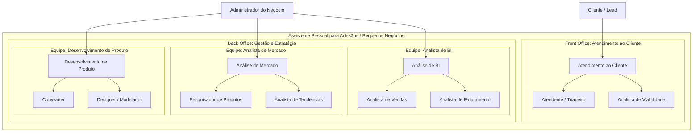

# 1. INTRODUÇÃO

Resumidamente, um assistente pessoal que opere em 5 frentes principais para um 
artesão, marceneiro, pintor, padeiro, etc.:

- **Atendimento ao cliente**: realiza triagem do cliente, análisa viabilidade do pedido, 
etc.;
- **Analista de BI**: verifica andamento das vendas, o que está sendo faturado, etc.;
- **Analista de mercado**: pesquisa produtos no mercado, verifica tendências, etc.;
- **Desenvolvimento de produto**: copywriting de produto, modelagem, etc.

Cada frente é uma equipe própria de agentes, podendo categorizar essas equipes 
conforme a separação de negócios comerciais dentro da teoria da administração:

- **Front Office**: responsáveis por lidarem diretamente com o cliente, operações de
entrada para a esteira de negócios;
- **Back Office**: atividades relacionadas a operações do negócio, infraestrutura, 
administração, etc.

O desenvolvimento pode ser separado em fases de acordo com cada frente, de maneira a
iniciar com a frente menos complexa (*front office*) e ir tocando as frentes mais 
complexas.

>   Atendimento ao cliente -> Analista de BI -> Analista de mercado -> 
>   Desenvolvimento de produtos 

Ou então pode ser organizado conforme o valor percebido pelo administrador do 
negócio.

# 2. CASOS DE USO (FRENTES)

O sistema possui apenas dois tipos de usuário: cliente/lead e administrador do 
negócio. O cliente/lead apenas possui acesso a frente de Atendimento ao cliente, o
administrador possui acesso às outras frentes, exclusivamente.

# 3. ARQUITETURA

Decisão de 20/10/2026 para o recorte atual: agente orquestrador, agente de atendimento e agente de orçamento. O comportamento está em [docs/recortes/orquestrador-e-atendimento.md](docs/recortes/orquestrador-e-atendimento.md).

## Stack

- **Python e Agno** para os três agentes, com saída estruturada.
- **API própria** para abrir ficha, mudar estado e montar o formulário. O modelo não grava **Recebido** nem **Resolvido**.
- **PostgreSQL** para conversa, catálogo, regra de custo e as duas esteiras.
- **Armazenamento de arquivos** para foto e referência.
- **WhatsApp** pelo provedor definido na análise.
- **Docker Compose** na VPS. Segredo fica fora do repositório.

## Um framework

O agente orquestrador classifica o motivo e encaminha. O agente de atendimento conversa no WhatsApp, consulta catálogo e esteira, e abre ficha. O agente de orçamento devolve uma proposta com campos fixos. A pessoa operadora recebe formulário e fila.

Esses três passos não deliberam em grupo. Um segundo framework, como o CrewAI, acrescentaria outra sessão, outro modelo de ferramenta e uma ponte entre os dois, sem mudar a regra de negócio. A fronteira já está no código: a mensagem entra, a ficha muda de estado e a resposta sai.

## Quando reabrir a decisão

Relatório para a pessoa operadora começa como consulta aos dados e um texto sobre o resultado, no mesmo serviço. O CrewAI volta a ser candidato se esse relatório precisar de papéis que se revisam antes de chegar a ela. Até lá, a stack permanece a desta seção.

